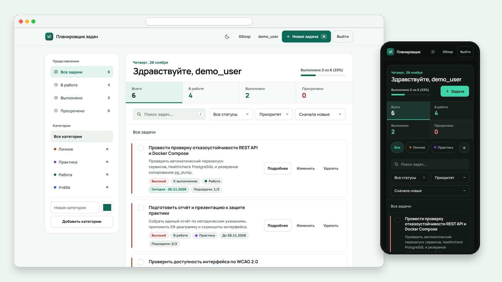
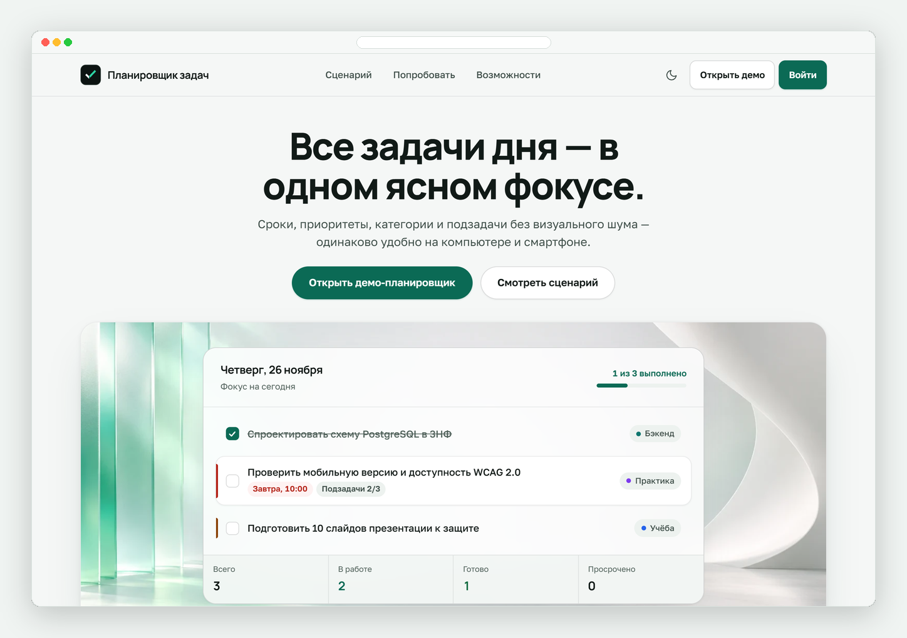
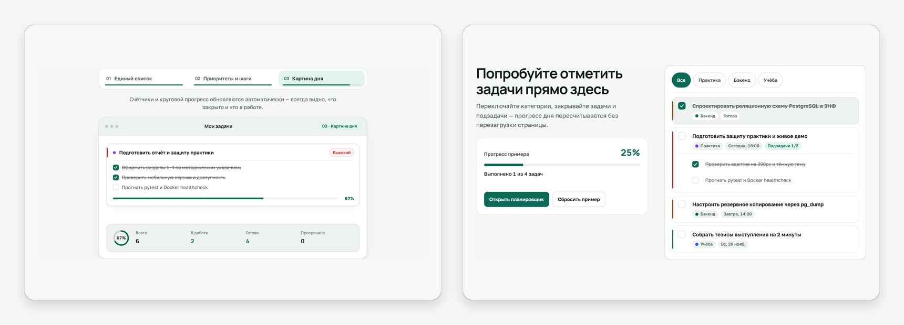
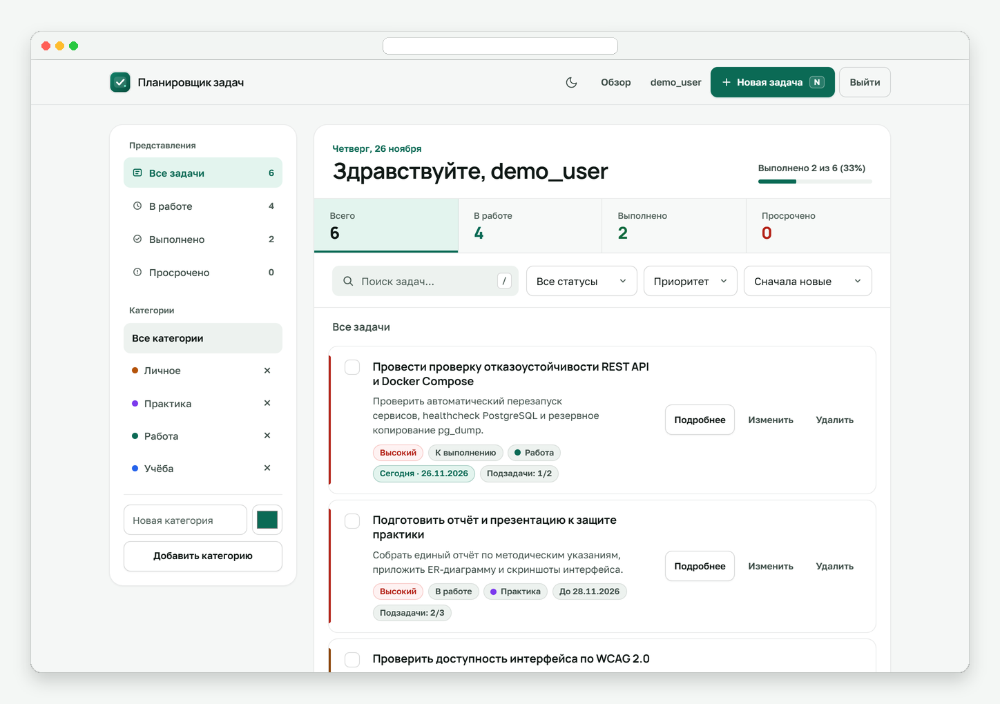
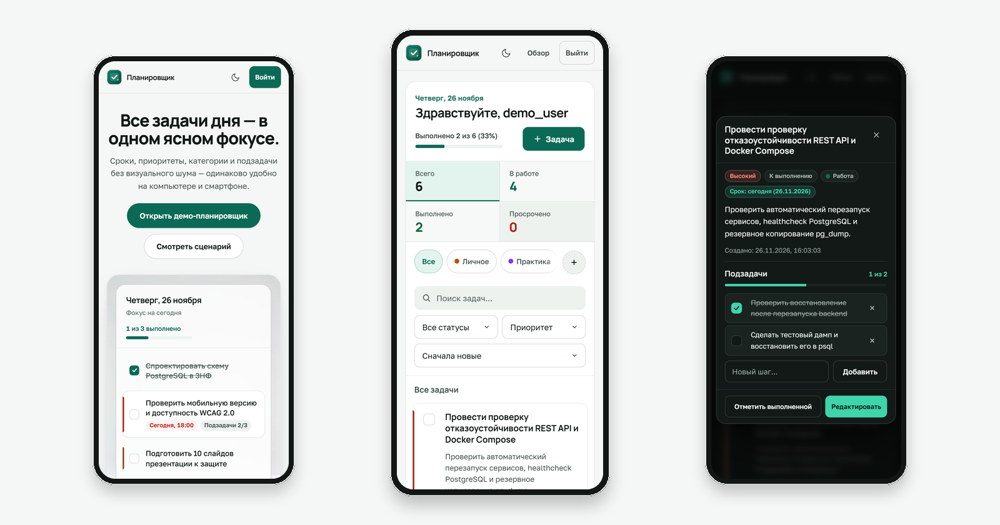
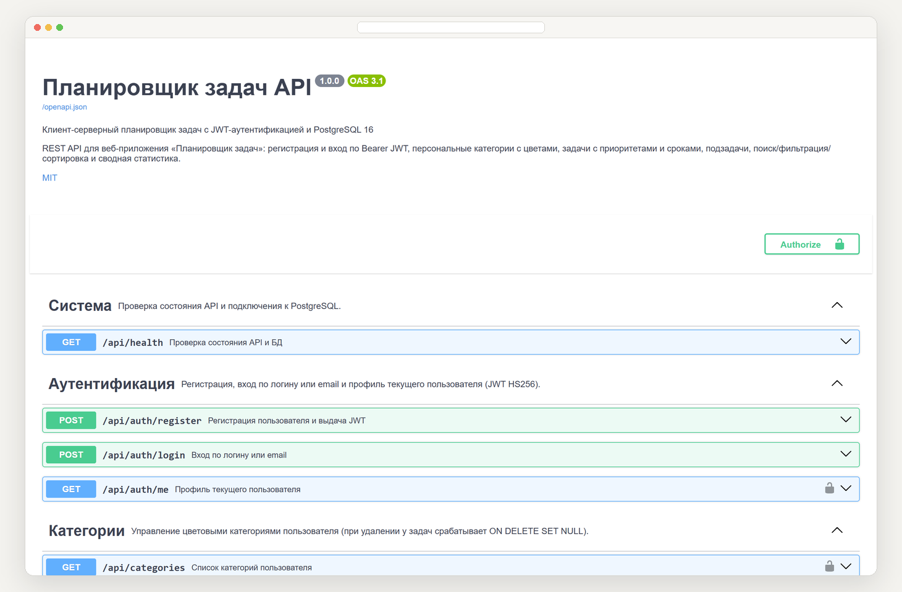
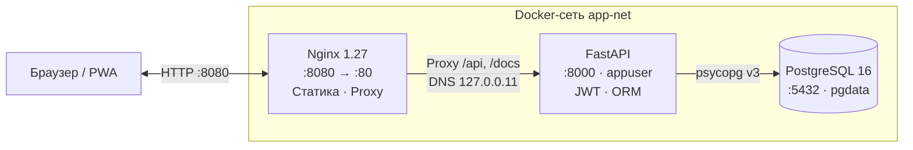
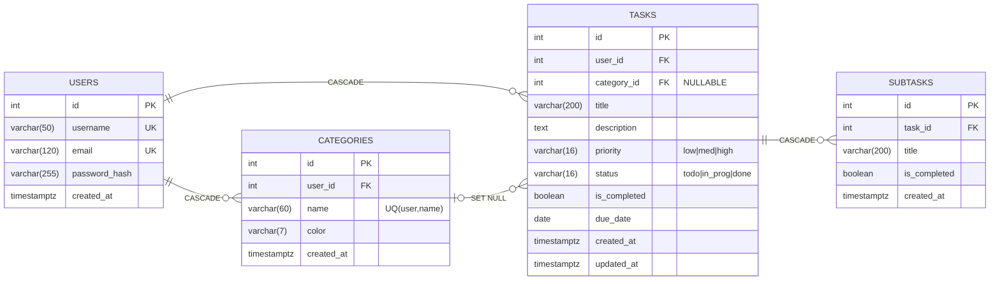

<div align="center">


# Планировщик задач

**Клиент-серверное веб-приложение для спокойного управления задачами, сроками, категориями и подзадачами**

[](https://github.com/APELSINKos/task-planner/actions/workflows/ci.yml)
[](https://apelsinkos.github.io/task-planner/)
[](#-доступность-wcag-20-aa-и-горячие-клавиши)
[](LICENSE)
<br />
[](backend/Dockerfile)
[](backend/app/main.py)
[](docker-compose.yml)
[](docker-compose.yml)

<p>
  <a href="https://apelsinkos.github.io/task-planner/"><strong>Открыть живое демо →</strong></a>
  &nbsp;·&nbsp;
  <a href="#-возможности">Возможности</a>
  &nbsp;·&nbsp;
  <a href="#-галерея-интерфейса">Интерфейс</a>
  &nbsp;·&nbsp;
  <a href="#-архитектура-и-база-данных">Архитектура</a>
  &nbsp;·&nbsp;
  <a href="#-быстрый-запуск">Запуск</a>
  &nbsp;·&nbsp;
  <a href="#-rest-api">API</a>
  &nbsp;·&nbsp;
  <a href="#-тестирование-ci-и-резервное-копирование">Тесты и CI</a>
</p>

<br />



</div>

---

## О проекте

**Планировщик задач** — полнофункциональное клиент-серверное веб-приложение, построенное на **FastAPI**, **PostgreSQL 16**, **Nginx 1.27** и нативном **HTML5 / CSS3 / ES6+ JavaScript** без тяжёлых фронтенд-фреймворков.

В основе интерфейса лежит собственная минималистичная дизайн-система (`Manrope` + `Golos Text`, светлая фарфоровая и тёмная графитовая темы с изумрудным акцентом, студийные растровые фоны WebP и нативная скролл-анимация без визуального шума). Весь стек разворачивается одной командой через **Docker Compose**, а интерактивная демонстрация интерфейса доступна прямо в браузере на **GitHub Pages**.

> **Живое демо без установки:** [apelsinkos.github.io/task-planner](https://apelsinkos.github.io/task-planner/)
> Статическая сборка в каталоге [`docs/`](docs/) использует локальный адаптер `localStorage` с предзаполненными задачами, категориями и подзадачами — можно сразу протестировать скролл-сценарий, интерактивный пример задач, рабочую область, тёмную тему и мобильный режим.

---

## ✨ Возможности

<table>
  <tr>
    <td valign="top" width="50%">
      <h3>Управление задачами и аналитика</h3>
      <ul>
        <li>Полный CRUD задач, цветовых категорий и вложенных подзадач с прогресс-баром выполнения.</li>
        <li>Три уровня приоритета (<code>low</code>, <code>medium</code>, <code>high</code>), статусы (<code>todo</code>, <code>in_progress</code>, <code>done</code>) и сроки с автоматическим расчётом просрочек.</li>
        <li>Мгновенная отметка выполнения, быстрый поиск с debounce, фильтрация по статусу/категории/приоритету и сортировка.</li>
        <li>Сводная статистика в реальном времени: всего, в работе, выполнено, просрочено и прогресс дня.</li>
      </ul>
    </td>
    <td valign="top" width="50%">
      <h3>Интерфейс, студийная графика и Motion</h3>
      <ul>
        <li>Hero-сцена с тематическими студийными фонами WebP (светлая и тёмная версии) и плавной глубиной при прокрутке.</li>
        <li>Трёхэтапный <code>sticky scroll</code> сценарий на <code>requestAnimationFrame</code> с горизонтальными вкладками этапов и плавным демпфированием.</li>
        <li>Интерактивный мини-планировщик прямо на стартовой странице: фильтрация по категориям, отметка задач и подзадач с мгновенным пересчётом прогресса.</li>
        <li>Светлая и тёмная темы с мгновенным применением без мерцания (<code>FOUC-free</code>) и сохранением в <code>localStorage</code>.</li>
      </ul>
    </td>
  </tr>
  <tr>
    <td valign="top" width="50%">
      <h3>Доступность WCAG 2.0 AA и PWA</h3>
      <ul>
        <li>Контрастность видимых текстов, кнопок и бейджей ≥ <code>5.5:1</code> в обеих темах (критерий 1.4.3 — от 4.5:1).</li>
        <li>Полная клавиатурная навигация: focus trap (<code>Tab</code>/<code>Shift+Tab</code>) в модалках, <code>Escape</code> с возвратом фокуса, сохранение фокуса при переключении чекбоксов, <code>/</code> для поиска и <code>N</code> для новой задачи.</li>
        <li>Подход <code>mobile-first</code>, зоны нажатия ≥ <code>44×44 px</code>, нулевой горизонтальный скролл на <code>390px</code> и поддержка <code>prefers-reduced-motion</code>.</li>
        <li>Манифест PWA (<code>manifest.webmanifest</code>) и Service Worker (<code>sw.js</code>) для кэширования оболочки и офлайн-доступа с учётом <code>Cache-Control</code>.</li>
      </ul>
    </td>
    <td valign="top" width="50%">
      <h3>Безопасность и DevOps</h3>
      <ul>
        <li>Аутентификация Bearer JWT (<code>HS256</code>, 24 ч) и хеширование паролей <code>bcrypt</code> (12 раундов) с проверкой ≤ 72 байт UTF-8.</li>
        <li>Строгая изоляция записей по <code>user_id</code>, защита от SQL-инъекций (ORM) и XSS (вывод через <code>textContent</code>).</li>
        <li>Изолированная Docker-сеть <code>app-net</code>, закрытый порт PostgreSQL 5432, запуск API от непривилегированного <code>appuser</code> и динамический DNS-резолвер в Nginx.</li>
        <li>Автотесты <code>pytest</code> (SQLite + PostgreSQL 16), GitHub Actions CI и скрипты бэкапа <code>pg_dump</code>.</li>
      </ul>
    </td>
  </tr>
</table>

---

## 🖼 Галерея интерфейса

> Изображения стартовой страницы и рабочей области автоматически подстраиваются под светлую или тёмную тему вашего профиля GitHub.

### Стартовая страница-визитка

<picture>
  <source media="(prefers-color-scheme: dark)" srcset="assets/landing-dark.png" />
  <source media="(prefers-color-scheme: light)" srcset="assets/landing-light.png" />
  
</picture>

### Скролл-сценарий и интерактивная песочница задач



### Рабочая область планировщика

<picture>
  <source media="(prefers-color-scheme: dark)" srcset="assets/workspace-dark.png" />
  <source media="(prefers-color-scheme: light)" srcset="assets/workspace-light.png" />
  
</picture>

### Мобильная адаптация (390px, light & dark)



<details>
  <summary><strong>Показать интерактивную документацию Swagger UI (<code>/docs</code>)</strong></summary>
  <br />
  
</details>

---

## 🏛 Архитектура и база данных

### Схема развёртывания (Docker Compose)

Все три контейнера работают в изолированной внутренней сети `app-net`. Порт PostgreSQL (`5432`) и порт FastAPI (`8000`) не публикуются на хост — весь внешний трафик проходит через единую точку входа Nginx (`:8080`), что исключает проблемы CORS и позволяет динамически переразрешать IP бэкенда через Docker DNS (`127.0.0.11`).



Порядок запуска гарантируется цепочкой `HEALTHCHECK` и `depends_on: condition: service_healthy`:
`db (pg_isready)` → `backend (GET /api/health)` → `frontend (wget http://127.0.0.1/)`.

### Реляционная схема базы данных (3НФ)

Схема приведена к третьей нормальной форме и включает 4 таблицы. Удаление категории безопасно сохраняет задачи пользователя (`ON DELETE SET NULL`), а удаление задачи автоматически очищает зависимые подзадачи (`ON DELETE CASCADE`).



---

## 🛠 Технологический стек

| Слой | Технологии |
|---|---|
| **Backend** | Python 3.12, FastAPI 0.115, Uvicorn, SQLAlchemy 2, Pydantic v2, PyJWT, bcrypt, psycopg v3 |
| **СУБД** | PostgreSQL 16 (`postgres:16-alpine`), SQLite in-memory (модульные тесты) |
| **Frontend** | HTML5 (семантические теги, WAI-ARIA), CSS3 (БЭМ, Flexbox, Grid, custom properties), Vanilla JS (ES6+, Fetch API, `rAF`), PWA (`manifest.webmanifest`, `sw.js`) |
| **Инфраструктура и QA** | Docker, Docker Compose, Nginx 1.27 Alpine, pytest, HTTPX TestClient, GitHub Actions CI, GitHub Pages, `pg_dump` |

---

## 📂 Структура репозитория

```text
task-planner/
├── .github/
│   ├── workflows/ci.yml        # GitHub Actions: pytest (SQLite + PostgreSQL 16), Compose & docs sync
│   ├── ISSUE_TEMPLATE/         # Шаблоны баг-репорта и предложений
│   └── PULL_REQUEST_TEMPLATE.md
├── assets/                     # Визуальные превью и скриншоты для README
├── backend/                    # REST API (FastAPI + SQLAlchemy 2 + Pydantic v2)
│   ├── app/
│   │   ├── auth.py             # bcrypt (12 раундов) и Bearer JWT (HS256)
│   │   ├── config.py           # Настройки pydantic-settings из .env
│   │   ├── database.py         # Синхронный движок SQLAlchemy и сессии
│   │   ├── main.py             # 18 эндпоинтов REST API, бизнес-логика и OpenAPI-теги
│   │   ├── models.py           # ORM-модели: users, categories, tasks, subtasks
│   │   └── schemas.py          # Схемы валидации и вычисляемое поле is_overdue
│   ├── tests/test_api.py       # Интеграционные и граничные тесты pytest (8 сценариев)
│   ├── Dockerfile              # python:3.12-slim, запуск от non-root appuser
│   └── requirements.txt
├── frontend/                   # Веб-интерфейс и обратный прокси Nginx
│   ├── css/styles.css          # Дизайн-система Alpine Clarity, светлая/тёмная темы, mobile-first
│   ├── js/api.js               # HTTP-клиент REST API (Fetch API + Bearer JWT)
│   ├── js/motion.js            # Скролл-сценарий (rAF), интерактивная песочница задач, переключение тем
│   ├── js/app.js               # Контроллер авторизации, задач, категорий, подзадач и модалок
│   ├── icons/                  # SVG-логотип, PWA-иконки (192/512) и Open Graph превью
│   ├── images/                 # Студийные растровые фоны WebP (светлая/тёмная hero-сцена и блок входа)
│   ├── index.html
│   ├── manifest.webmanifest
│   ├── sw.js                   # Service Worker (кэш статики + офлайн-fallback)
│   ├── nginx.conf              # Gzip, security headers, динамический DNS-прокси на backend:8000
│   └── Dockerfile              # nginx:1.27-alpine
├── docs/                       # Автономная сборка для GitHub Pages (localStorage-адаптер api.js)
├── scripts/                    # Скрипты резервного копирования PostgreSQL (pg_dump)
│   ├── backup_db.sh
│   └── backup_db.ps1
├── docker-compose.yml          # Оркестрация db + backend + frontend с healthcheck и томом pgdata
├── .env.example                # Шаблон переменных окружения
├── CHANGELOG.md                # Журнал изменений по релизам
└── LICENSE                     # Лицензия MIT
```

---

## 🚀 Быстрый запуск

Требуются установленные **Docker Engine** и **Docker Compose**. Конфигурация считывается из `.env` (шаблон — [`.env.example`](.env.example)).

```bash
git clone https://github.com/APELSINKos/task-planner.git
cd task-planner
cp .env.example .env
docker compose up --build -d
docker compose ps
```

### Точки входа после запуска

| Сервис | Адрес | Назначение |
|---|---|---|
| Веб-приложение | `http://localhost:8080` | Стартовая визитка и рабочая область планировщика |
| Swagger UI | `http://localhost:8080/docs` | Интерактивная спецификация OpenAPI 3.1 |
| Healthcheck | `http://localhost:8080/api/health` | Проверка доступности API и PostgreSQL (`{"status":"ok","database":"connected"}`) |

Остановка сервисов (данные в томе `pgdata` сохраняются):

```bash
docker compose down
```

### Переменные окружения

| Переменная | Значение по умолчанию | Назначение |
|---|---|---|
| `POSTGRES_DB` | `taskplanner` | Имя базы данных PostgreSQL |
| `POSTGRES_USER` | `taskuser` | Пользователь СУБД |
| `POSTGRES_PASSWORD` | `change_me_strong_password` | Пароль пользователя СУБД |
| `DATABASE_URL` | `postgresql+psycopg://...@db:5432/taskplanner` | Строка подключения SQLAlchemy |
| `JWT_SECRET` | `change_me_jwt_secret_key_at_least_32_chars` | Секретный ключ подписи JWT (`HS256`, от 32 символов) |
| `JWT_EXPIRE_MINUTES` | `1440` | Время жизни токена в минутах (24 часа) |
| `CORS_ORIGINS` | `http://localhost:8080,http://127.0.0.1:8080` | Разрешённые источники CORS |
| `APP_PORT` | `8080` | Внешний порт контейнера Nginx |
| `TZ` | `Europe/Moscow` | Часовой пояс бэкенда для расчёта сроков и просрочек (`is_overdue`) |

---

## 📡 REST API

Все защищённые маршруты принимают заголовок `Authorization: Bearer <access_token>`. При регистрации пользователя автоматически создаются 3 базовые категории (`Учёба`, `Работа`, `Личное`).

| Группа | Метод | Эндпоинт | Доступ | Описание |
|---|---|---|---|---|
| **Система** | `GET` | `/api/health` | Публичный | Проверка состояния API и подключения к PostgreSQL |
| **Аутентификация** | `POST` | `/api/auth/register` | Публичный | Регистрация пользователя, создание стартовых категорий, выдача JWT |
| | `POST` | `/api/auth/login` | Публичный | Вход по логину или email и выдача JWT |
| | `GET` | `/api/auth/me` | JWT | Профиль текущего авторизованного пользователя |
| **Категории** | `GET` | `/api/categories` | JWT | Список категорий пользователя (сортировка по имени) |
| | `POST` | `/api/categories` | JWT | Создание категории с HEX-цветом (проверка дублей через `casefold`) |
| | `PUT` | `/api/categories/{id}` | JWT | Переименование или смена цвета категории |
| | `DELETE` | `/api/categories/{id}` | JWT | Удаление категории (`tasks.category_id` становится `NULL`) |
| **Задачи** | `GET` | `/api/tasks` | JWT | Список задач (`completed`, `status`, `priority`, `category_id`, `search`, `sort`) |
| | `GET` | `/api/tasks/stats` | JWT | Сводная статистика (`total`, `active`, `completed`, `overdue`, приоритеты) |
| | `POST` | `/api/tasks` | JWT | Создание новой задачи |
| | `GET` | `/api/tasks/{id}` | JWT | Детальная карточка задачи с категорией и подзадачами |
| | `PUT` | `/api/tasks/{id}` | JWT | Полное или частичное обновление полей задачи |
| | `PATCH` | `/api/tasks/{id}/toggle` | JWT | Быстрое переключение статуса выполнения |
| | `DELETE` | `/api/tasks/{id}` | JWT | Удаление задачи и её подзадач (`CASCADE`) |
| **Подзадачи** | `POST` | `/api/tasks/{id}/subtasks` | JWT | Добавление подзадачи к выбранной задаче |
| | `PATCH` | `/api/subtasks/{id}/toggle` | JWT | Переключение статуса выполнения подзадачи |
| | `DELETE` | `/api/subtasks/{id}` | JWT | Удаление подзадачи |

<details>
  <summary><strong>Пример быстрого сценария через <code>curl</code></strong></summary>

```bash
# 1. Проверка готовности сервиса
curl -s http://localhost:8080/api/health

# 2. Регистрация и получение JWT
TOKEN=$(curl -s -X POST http://localhost:8080/api/auth/register \
  -H "Content-Type: application/json" \
  -d '{"username":"demo_dev","email":"demo@example.com","password":"StrongPassword123"}' \
  | python3 -c "import sys, json; print(json.load(sys.stdin)['access_token'])")

# 3. Создание задачи
curl -s -X POST http://localhost:8080/api/tasks \
  -H "Authorization: Bearer $TOKEN" \
  -H "Content-Type: application/json" \
  -d '{"title":"Проверить развёртывание Docker Compose","priority":"high","due_date":"2027-01-15"}'

# 4. Получение сводной статистики
curl -s http://localhost:8080/api/tasks/stats \
  -H "Authorization: Bearer $TOKEN"
```

</details>

---

## ♿ Доступность (WCAG 2.0 AA) и горячие клавиши

Интерфейс проверен в светлой и тёмной темах на экранах `390px`, `768px` и `1440px` (включая `prefers-reduced-motion: reduce`):

| Клавиша | Контекст | Действие |
|---|---|---|
| `/` | Рабочая область | Фокус на строке поиска задач (работает в EN и RU раскладке) |
| `N` | Рабочая область | Открытие формы создания новой задачи (работает в EN и RU раскладке) |
| `Space` · `Enter` | Задачи, фильтры и песочница | Отметка выполнения задач/подзадач с сохранением фокуса и переключение фильтров |
| `←` · `→` | Вкладки «Вход / Регистрация» | Переключение вкладок по паттерну WAI-ARIA `tablist` |
| `Tab` / `Shift+Tab` | Модальные окна | Замкнутый фокус (focus trap) внутри открытого диалога |
| `Escape` | Модальные окна | Закрытие диалога с возвратом фокуса на элемент-триггер |

---

## 🧪 Тестирование, CI и резервное копирование

### Автоматизированные тесты (`pytest`)

Тестовый набор [`backend/tests/test_api.py`](backend/tests/test_api.py) проверяет healthcheck, регистрацию/вход/JWT, CRUD категорий, задач и подзадач, каскадное удаление и `SET NULL`, изоляцию данных между пользователями, ограничение `bcrypt` на 72 байта UTF-8, экранирование спецсимволов `%`/`_` в `ILIKE`, конфликты `IntegrityError` (`409`) и противоречивые статусы (`422`).

```bash
# Прогон в контейнере (SQLite in-memory)
docker compose exec backend pytest -v

# Прогон против реальной PostgreSQL 16 (на отдельной временной БД)
docker compose exec db psql -U taskuser -d postgres -c "CREATE DATABASE taskplanner_test;"
docker compose exec backend sh -c 'TEST_DATABASE_URL="${DATABASE_URL%/*}/taskplanner_test" pytest -v'
docker compose exec db psql -U taskuser -d postgres -c "DROP DATABASE taskplanner_test;"
```

### Непрерывная интеграция (GitHub Actions)

Workflow [`.github/workflows/ci.yml`](.github/workflows/ci.yml) автоматически запускается при каждом `push` и `pull_request` в ветку `main`:
1. Проверяет компиляцию модулей Python и прогоняет `pytest -v` на **SQLite** и реальном сервис-контейнере **PostgreSQL 16**.
2. Валидирует конфигурацию `docker compose config --quiet`.
3. Гарантирует синхронность статических файлов между `frontend/` и публикацией GitHub Pages `docs/`.

### Резервное копирование и восстановление PostgreSQL

```bash
# Linux / macOS / Git Bash
./scripts/backup_db.sh

# Windows PowerShell
.\scripts\backup_db.ps1
```

Восстановление из SQL-дампа:

```bash
docker compose exec -T db psql -v ON_ERROR_STOP=1 --single-transaction -U taskuser -d taskplanner < backups/<имя_дампа>.sql
```

---

## 🗓 Этапы разработки

| Версия | Период | Основные результаты |
|---|---|---|
| Подготовка | 13 сентября – 11 октября | Инициализация репозитория, шаблоны GitHub, анализ предметной области, User Stories, MoSCoW и схема 3НФ |
| [`v0.1.0`](../../tree/v0.1.0) | 12 октября – 13 ноября | Проектирование БД в 3НФ, FastAPI REST API, JWT + bcrypt, автотесты `pytest`, OpenAPI и Code-Review (PR #1) |
| [`v0.2.0`](../../tree/v0.2.0) | 16 ноября – 20 ноября | Семантическая вёрстка HTML5/CSS3/БЭМ, Fetch API, PWA-манифест и демо на GitHub Pages (PR #2) |
| [`v0.3.0`](../../tree/v0.3.0) | 21 ноября – 23 ноября | Финальная сборка Docker Compose, скрипты `pg_dump`, QA-усиление Nginx/API/фронтенда и базовый CI (PR #3, #4) |
| [`v1.0.0`](../../tree/v1.0.0) | 24 ноября – 26 ноября | Дизайн-система Alpine Clarity, студийная графика WebP, 3-этапный скролл-сценарий, песочница задач, тёмная тема, аудит WCAG 2.0/PWA и расширенный CI (PR #5, #6) |

Полная история изменений ведётся в [`CHANGELOG.md`](CHANGELOG.md). Проект распространяется под лицензией [MIT](LICENSE).
