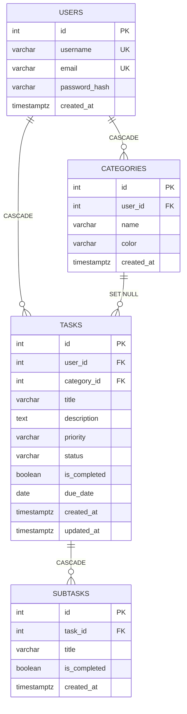
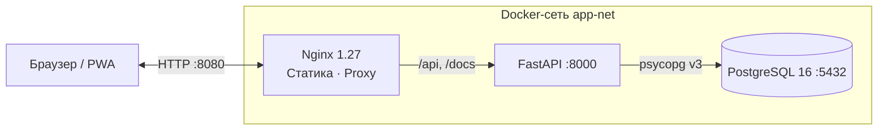

# Планировщик задач (Task Planner)

Клиент-серверное веб-приложение для системного управления личными и учебными задачами.

## О проекте

Приложение решает проблему разрозненного хранения дел в заметках, чатах и локальных файлах: единое пространство для задач, сроков, приоритетов, категорий и подзадач с синхронизацией между компьютером и смартфоном.

### Целевая аудитория
- Студенты при планировании учебных работ, дедлайнов и практик.
- Разработчики и небольшие команды для ведения личного бэклога задач.

## Пользовательские истории (User Stories) и границы MVP

1. **Регистрация и вход:** как пользователь, я хочу создать учётную запись и войти в систему, чтобы мои задачи были доступны с разных устройств и изолированы от других пользователей.
2. **Управление задачами:** как пользователь, я хочу создавать, редактировать, удалять и отмечать задачи выполненными в один клик, чтобы оперативно вести список дел.
3. **Категории и подзадачи:** как пользователь, я хочу группировать задачи по цветовым категориям (с сохранением задач при удалении категории) и разбивать крупные работы на чек-лист подзадач.
4. **Приоритеты, сроки и поиск:** как пользователь, я хочу задавать приоритет и дедлайн, видеть просроченные задачи, искать по тексту, фильтровать и сортировать список.
5. **Адаптивный доступ:** как пользователь, я хочу удобно работать со списком задач со смартфона и десктопа, а также открывать веб-демо без локальной установки.

## Приоритизация требований (MoSCoW)

| Приоритет | Состав функциональности |
|---|---|
| **Must Have** | Регистрация и аутентификация (JWT), список задач, создание/редактирование/удаление задач, отметка выполнения, изоляция данных по пользователю |
| **Should Have** | Цветовые категории (`ON DELETE SET NULL`), подзадачи (`ON DELETE CASCADE`), приоритеты (`low`/`medium`/`high`), сроки и просрочки, поиск, фильтрация, сортировка, статистика, адаптивная вёрстка (WCAG 2.0) |
| **Could Have** | Манифест PWA и базовый Service Worker, статическое демо на GitHub Pages, скрипты резервного копирования PostgreSQL (`pg_dump`) |
| **Won't Have** | Push/Telegram-уведомления по расписанию, совместные командные доски с ролевой моделью |

## Планируемый стек технологий

- **Backend:** Python 3.12, FastAPI, SQLAlchemy 2, Pydantic v2, PyJWT, bcrypt, psycopg v3
- **СУБД:** PostgreSQL 16 (`postgres:16-alpine`)
- **Frontend:** HTML5 (семантические теги, WAI-ARIA), CSS3 (БЭМ, Flexbox, Grid, mobile-first), Vanilla JS (ES6+, Fetch API), PWA
- **Инфраструктура и QA:** Docker, Docker Compose, Nginx 1.27, pytest

## Планируемая структура репозитория

```text
task-planner/
├── backend/       # REST API на FastAPI, модели ORM, схемы Pydantic, тесты pytest
├── frontend/      # Адаптивный веб-интерфейс и обратный прокси Nginx
├── docs/          # Статическая демо-сборка для GitHub Pages
├── scripts/       # Скрипты резервного копирования PostgreSQL
└── docker-compose.yml
```

## Проектирование базы данных (3НФ)

Схема приведена к третьей нормальной форме и включает 4 связанные таблицы:
- `users` (`id`, `username`, `email`, `password_hash`, `created_at`) — учётные записи пользователей.
- `categories` (`id`, `user_id`, `name`, `color`, `created_at`) — уникальные цветовые категории пользователя (`ON DELETE CASCADE` от `users`).
- `tasks` (`id`, `user_id`, `category_id`, `title`, `description`, `priority`, `status`, `is_completed`, `due_date`, `created_at`, `updated_at`) — задачи (`ON DELETE SET NULL` от `categories`).
- `subtasks` (`id`, `task_id`, `title`, `is_completed`, `created_at`) — вложенные шаги (`ON DELETE CASCADE` от `tasks`).



## Архитектура развёртывания

Три контейнера объединяются во внутренней Docker-сети `app-net`:
- `db` (`postgres:16-alpine`) — СУБД с томом `pgdata`, порт `5432` закрыт от внешнего мира.
- `backend` (`python:3.12-slim`) — FastAPI на `:8000`, запуск от непривилегированного `appuser`.
- `frontend` (`nginx:1.27-alpine`) — единая точка входа `:8080`, раздача статики и обратный прокси `/api/*` и `/docs`.



## Реестр ключевых рисков

| Риск | Меры снижения |
|---|---|
| Потеря данных БД или утечка секретов в Git | Именованный том `pgdata`, скрипты `pg_dump`, исключение `.env` через `.gitignore` |
| Нарушение изоляции данных между пользователями | Обязательная фильтрация всех запросов по `user_id` из JWT и автотесты `pytest` |
| Несовместимость макета на узких мобильных экранах | Подход `mobile-first`, контроль ширины `390px` и зон нажатия ≥ `44×44 px` |
